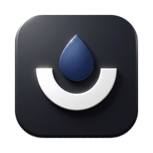

<div align="center">



# Personal Downloader

**A free, open-source video and music downloader for macOS, Windows and Linux.**<br>
A clean desktop app (yt-dlp GUI) for YouTube, Instagram, X/Twitter, SoundCloud, TikTok and [1,000+ more sites](https://github.com/yt-dlp/yt-dlp/blob/master/supportedsites.md).

[](https://github.com/LordVersA/personal-downloader/releases/latest)
[](https://github.com/LordVersA/personal-downloader/releases)
[](https://github.com/LordVersA/personal-downloader/actions/workflows/release.yml)
[](#install)
[](LICENSE)

[**Download**](https://github.com/LordVersA/personal-downloader/releases/latest) · [Features](#features) · [FAQ](#faq)

</div>

## Features

- **Paste and pick**: every resolution up to 4K/8K with codec, fps, HDR, bitrate and size shown up front.
- **Any output format**: MP4, MKV, WebM or MOV video; MP3, M4A, Opus, FLAC or WAV audio.
- **Music ready**: square cover art and full tags (title, artist, album, date) on every audio download.
- **Signed-in downloads**: import cookies from Chrome, Firefox, Safari, Edge or Brave for private, age-restricted or members-only content.
- **Subtitles, chapters, metadata and SponsorBlock**, remembered between downloads.
- **Fast**: 8 parallel connections, a download queue with pause and resume, and proxy support (HTTP/SOCKS5).
- **Clear errors**: yt-dlp failures explained in plain language, with what to do next.
- **Always up to date**: yt-dlp updates in one click; the app updates itself with small delta updates.
- Right-to-left titles (Farsi, Arabic) display correctly.

## Install

Grab the latest build from [**Releases**](https://github.com/LordVersA/personal-downloader/releases/latest):

| Platform | File |
| --- | --- |
| macOS (Apple Silicon / Intel) | `osx-arm64-Setup.pkg` / `osx-x64-Setup.pkg` |
| Windows | `win-x64-Setup.exe` |
| Linux | `linux-x64.AppImage` |

On first launch the app downloads yt-dlp, ffmpeg and deno (checked against their SHA-256 sums).

## FAQ

**macOS says the app can't be opened.** Builds aren't notarized yet: right-click the app → **Open** the first time.

**YouTube says "confirm you're not a bot", or a post is private.** Settings → **Browser cookies** → pick your browser → **Import**.
On macOS, Safari and Chrome need **Full Disk Access** for the app; the app opens that settings page for you.

**A site stopped working.** Settings → yt-dlp → **Check now** to update yt-dlp.

## Build from source

```sh
npm install
npm run tauri dev
```

Releases: push a tag (`git tag v1.2.3 && git push origin v1.2.3`) and [CI](.github/workflows/release.yml) builds every platform,
packs it with [Velopack](https://velopack.io) (with a delta against the previous release) and publishes the GitHub Release.

## License

[GPL-3.0](LICENSE). Powered by [yt-dlp](https://github.com/yt-dlp/yt-dlp), [FFmpeg](https://ffmpeg.org) and [Tauri](https://tauri.app).
Download only content you have the right to download.
