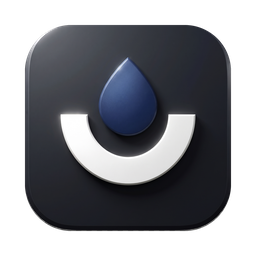

<div align="center">



# Personal Downloader

**Videos, music, galleries, live streams, direct files and torrents. One desktop app.**<br>
Free and open source for macOS, Windows and Linux. Paste a link or open a `.torrent` file; the app chooses the download tool for you.

[](https://github.com/LordVersA/personal-downloader/releases/latest)
[](https://github.com/LordVersA/personal-downloader/releases)
[](https://github.com/LordVersA/personal-downloader/actions/workflows/release.yml)
[](#install)
[](LICENSE)

[**Download**](https://github.com/LordVersA/personal-downloader/releases/latest) · [Install](#install) · [Features](#features) · [Tools](#download-tools) · [FAQ](#faq)

</div>

## Install

Choose your platform to download the latest installer:

[](https://github.com/LordVersA/personal-downloader/releases/latest/download/PersonalDownloader-osx-arm64-Setup.pkg)
[](https://github.com/LordVersA/personal-downloader/releases/latest/download/PersonalDownloader-osx-x64-Setup.pkg)
[](https://github.com/LordVersA/personal-downloader/releases/latest/download/PersonalDownloader-win-x64-Setup.exe)
[](https://github.com/LordVersA/personal-downloader/releases/latest/download/PersonalDownloader-linux-x64.AppImage)

| Platform | Install | Portable download |
| --- | --- | --- |
| macOS · Apple Silicon (M-series) | Open the [`.pkg` installer](https://github.com/LordVersA/personal-downloader/releases/latest/download/PersonalDownloader-osx-arm64-Setup.pkg) and follow the steps. | [ZIP](https://github.com/LordVersA/personal-downloader/releases/latest/download/PersonalDownloader-osx-arm64-Portable.zip) |
| macOS · Intel | Open the [`.pkg` installer](https://github.com/LordVersA/personal-downloader/releases/latest/download/PersonalDownloader-osx-x64-Setup.pkg) and follow the steps. | [ZIP](https://github.com/LordVersA/personal-downloader/releases/latest/download/PersonalDownloader-osx-x64-Portable.zip) |
| Windows · x64 | Run the [`.exe` installer](https://github.com/LordVersA/personal-downloader/releases/latest/download/PersonalDownloader-win-x64-Setup.exe). | [ZIP](https://github.com/LordVersA/personal-downloader/releases/latest/download/PersonalDownloader-win-x64-Portable.zip) |
| Linux · x64 | Download the [AppImage](https://github.com/LordVersA/personal-downloader/releases/latest/download/PersonalDownloader-linux-x64.AppImage), make it executable, then open it. | AppImage is portable. |

```sh
# Linux: run from the folder containing the downloaded AppImage
chmod +x PersonalDownloader-linux-x64.AppImage
./PersonalDownloader-linux-x64.AppImage
```

On first launch, the app downloads yt-dlp, FFmpeg/ffprobe, Deno and aria2c, verifying their SHA-256 checksums. An internet connection is required. Optional tools install when needed, or ahead of time from **Settings → Tools**.

[All releases and assets](https://github.com/LordVersA/personal-downloader/releases) · Builds are not notarized on macOS; see the [FAQ](#faq) for first launch.

## Get started

1. Paste a video, playlist, direct file URL or magnet link. Use **Open .torrent file** for a torrent on your computer.
2. Leave **Download with → Automatic** selected. Choose quality, format or files when prompted.
3. Start the download and follow its progress in **Library**. Open the result or reveal it in your file manager.

For restricted sites, configure **Settings → Connection** to import browser cookies or set a proxy. **Settings → Tools → Supported sites** provides a searchable directory by source type and tool.

## Features

- **Video and audio:** choose from the qualities a site provides, with resolution, codec, frame rate and estimated size shown before downloading.
- **Playlists and channels:** search and select entries, choose a shared quality, and save into a playlist folder.
- **Formats:** MP4, MKV, WebM and MOV video; MP3, M4A, Opus, FLAC and WAV audio, with optional metadata, cover art, subtitles and chapters.
- **More input types:** direct file links, magnet links, local `.torrent` files, image galleries, live broadcasts and unencrypted HLS/DASH manifests.
- **Spotify links:** reads public track, album and playlist metadata, then searches YouTube Music for the audio. Results depend on the available match.
- **Configurable acceleration:** aria2c connections, parallel splits, bandwidth limits, timeouts, retries, peer limits and file allocation, saved in a dedicated settings tab.
- **Compact Library:** live transfer stats, actual downloader badges, and quality, format and size beside each saved file.
- **Connection controls:** HTTP/SOCKS5 proxies and browser-cookie import. Preview images also use the selected proxy; aria2c itself requires HTTP or a direct connection.
- **Activity logs:** a rolling, fading preview with an expandable, scrollable view of the latest 2,000 lines per link.
- **Managed tools:** installed versions, download/update controls, repository links and explanations of when each tool is needed.
- **Desktop integration:** light/dark appearance, right-to-left titles, completion notifications and automatic app updates through Velopack.

## Download tools

| Tool | What it does |
| --- | --- |
| [yt-dlp](https://github.com/yt-dlp/yt-dlp) | Videos, audio, playlists and channels from supported websites. |
| [FFmpeg / ffprobe](https://github.com/FFmpeg/FFmpeg) | Merges tracks, converts formats and reads media information. |
| [Deno](https://github.com/denoland/deno) | Runs JavaScript challenges needed by some video sites. |
| [aria2c](https://github.com/aria2/aria2) | Direct files, torrents and accelerated HTTP downloads. |
| [gallery-dl](https://github.com/mikf/gallery-dl) | Image galleries and collections. Installed on demand. |
| [Streamlink](https://github.com/streamlink/streamlink) | Records supported live streams. Installed on demand. |
| [N_m3u8DL-RE](https://github.com/nilaoda/N_m3u8DL-RE) | Unencrypted HLS/DASH links. Installed on demand. |
| [uv](https://github.com/astral-sh/uv) | Installs the optional Python tools and their runtime. |

Some tools use pinned, checksum-verified builds; **Update** reinstalls the configured build. Site support depends on the tool version, the URL and your sign-in permissions. Torrent peers can see your IP address; seeding stops after completion. Encrypted manifests are rejected.

## FAQ

**macOS says the app can't be opened.** Builds aren't notarized yet. Right-click the app and choose **Open** on first launch.

**YouTube asks to confirm you're not a bot, or a post is private.** Open **Settings → Connection → Browser cookies**, select the browser where you're signed in, then import. On macOS, Safari and Chrome may require Full Disk Access for the app; the import flow can open that settings page.

**A site stopped working.** Open **Settings → Tools** and update the relevant tool. Use **Supported sites** to find the appropriate tool. Some sites require fresh browser cookies.

**How do I use a proxy?** Set it in **Settings → Connection**, then use **Test**. The proxy applies to media previews as well as supported download tools. For aria2c files and torrents, use an HTTP proxy or a direct connection; SOCKS proxies disable yt-dlp acceleration.

**How do I adjust download speed?** Open **Settings → aria2c**. Connections and splits control parallel transfer requests; speed limits use KiB/s, with `0` meaning unlimited. Each field has a help hint. Changes apply to new downloads; the queue processes one normal download at a time.

## Build from source

Use Node.js 22+, Rust (the toolchain is pinned in `src-tauri/rust-toolchain.toml`), and the platform's Tauri build dependencies. Linux packages used by CI are listed in [the CI workflow](.github/workflows/ci.yml).

```sh
npm ci
npm run tauri dev
```

Run checks:

```sh
npm test
node --check src/main.js
cd src-tauri
cargo fmt --check
cargo clippy --locked -- -D warnings
cargo test --locked --lib
```

Releases: push a version tag, such as `v1.0.0`. The [release workflow](.github/workflows/release.yml) builds macOS arm64/x64, Windows x64 and Linux x64, packs them with Velopack, and publishes installers, portable builds and update packages. The [aria2c workflow](.github/workflows/aria2.yml) publishes the checksum-verified dependency assets separately.

## License

[GPL-3.0](LICENSE). Built with [Tauri](https://tauri.app) and the download tools listed above.
Download only content you have the right to download.
